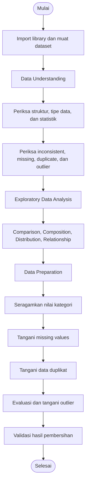

# Panduan Kode Mini Project 1 - Study Club Data Science

Panduan praktis penggunaan Python untuk **Mini Project 1 Study Club Data Science**, mulai dari **Data Understanding**, **Exploratory Data Analysis (EDA)**, hingga **Data Preparation**. Contoh kode dirancang untuk dijalankan secara berurutan di **Google Colab** atau Jupyter Notebook.

> **Penting:** `kolom1`, `kolom2`, dan seterusnya merupakan **placeholder**. Ganti dengan nama kolom asli pada dataset masing-masing. Penomorannya berlaku **per blok kode**, sehingga `kolom1` pada blok yang berbeda tidak harus merujuk kolom yang sama.

## Daftar Isi

- [Alur Analisis](#alur-analisis)
- [Persiapan](#persiapan)
- [1. Data Understanding](#1-data-understanding)
- [2. Exploratory Data Analysis (EDA)](#2-exploratory-data-analysis-eda)
- [3. Data Preparation](#3-data-preparation)
- [Kesalahan yang Sering Terjadi](#kesalahan-yang-sering-terjadi)

## Alur Analisis

Diagram berikut merangkum urutan tahapan yang dibahas pada panduan ini.



## Persiapan

### Import library

```python
import pandas as pd
import numpy as np
import seaborn as sns
import matplotlib.pyplot as plt
```

### Cara menggunakan panduan

1. Buka notebook di Google Colab atau Jupyter Notebook.
2. Jalankan kode **dari atas ke bawah** atau **Run All**.
3. Cek nama kolom dengan `df.columns` lalu ganti semua placeholder sesuai dataset.
4. Bedakan kolom **kategori** (teks/kelompok) dari kolom **numerik** (angka).
5. Interpretasikan hasil sebelum memutuskan tindakan pembersihan. Tidak semua nilai yang jarang muncul perlu dihapus.

---

## 1. Data Understanding

Tahap awal untuk mengenali struktur, kualitas, dan karakteristik dataset.

### 1.1 Memuat dataset

Contoh berikut membaca CSV yang tersedia melalui Google Drive (sesuai sumber panduan).

```python
file_id = '17823avvjAEOUwuHsFwQcUXrCbk6kzuU-'
url = f'https://drive.google.com/uc?id={file_id}'

df = pd.read_csv(url)
df.head()
```

> Ganti `file_id` jika menggunakan dataset lain. File Google Drive harus memiliki izin akses yang sesuai. Jika mengunggah CSV langsung ke Colab, dapat menggunakan `pd.read_csv('nama_file.csv')`.

### 1.2 Informasi dasar

```python
df.info()
df.columns
```

`df.info()` menampilkan jumlah baris, kolom, tipe data, dan jumlah nilai non-null.

### 1.3 Statistik deskriptif

```python
df.describe(include='all')
```

### 1.4 Mengecek tipe data

```python
df.dtypes
```

Kolom angka umumnya bertipe `int64` atau `float64`. Apabila terbaca sebagai `object`, cek kemungkinan campuran teks, simbol, atau format angka yang tidak konsisten.

### 1.5 Mengecek inconsistent values

```python
print(df['kolom1'].unique())
print(df['kolom2'].unique())
print(df['kolom3'].unique())
# Tambahkan kolom lain yang ingin diperiksa.
```

**Pilih kolom kategori.** Amati perbedaan kapitalisasi, spasi di awal/akhir, atau ejaan yang mengacu pada kategori sama.

### 1.6 Mengecek missing values

```python
pd.DataFrame(
    df.isna().sum() / len(df) * 100,
    columns=['Null Ratio in %']
)
```

### 1.7 Mengecek duplicated values

```python
df[df.duplicated()]
```

### 1.8 Mengecek outliers dengan IQR

Kode di bawah otomatis mengecek semua kolom numerik.

```python
results = []
cols = df.select_dtypes(include=['number'])

for col in cols:
    q1 = df[col].quantile(0.25)
    q3 = df[col].quantile(0.75)
    iqr = q3 - q1
    lower_bound = q1 - 1.5 * iqr
    upper_bound = q3 + 1.5 * iqr

    outliers = df[(df[col] < lower_bound) | (df[col] > upper_bound)]
    percent_outliers = len(outliers) / len(df) * 100
    results.append({
        'Kolom': col,
        'Persentase Outliers': percent_outliers
    })

results_df = pd.DataFrame(results).set_index('Kolom')
display(results_df)
```

> Metode IQR menandai nilai ekstrem secara statistik; nilainya belum tentu salah. Sesuaikan interpretasi dengan konteks dataset.

---

## 2. Exploratory Data Analysis (EDA)

Gunakan visualisasi untuk memahami pola serta hubungan antarkolom. Nama kolom pada setiap contoh wajib disesuaikan.

### 2.1 Comparison - Bar chart

Membandingkan **rata-rata nilai numerik** pada beberapa kelompok kategori.

```python
# kolom1 = kategori, kolom2 = numerik
rata = df.groupby('kolom1')['kolom2'].mean().sort_values(ascending=False)

plt.figure(figsize=(10, 6))
sns.barplot(x=rata.index, y=rata.values, hue=rata.index, palette='viridis', legend=False)
plt.title('Rata-rata kolom2 Berdasarkan kolom1')
plt.xlabel('kolom1')
plt.ylabel('Rata-rata kolom2')
plt.xticks(rotation=45)
plt.tight_layout()
plt.show()
```

### 2.2 Composition - Pie chart

Menampilkan proporsi tiap kategori; lebih mudah dibaca jika jumlah kategori sedikit, misalnya **2–6 kategori**.

```python
# kolom1 = kategori
komposisi = df['kolom1'].value_counts()

plt.figure(figsize=(10, 8))
komposisi.plot(kind='pie', autopct='%1.1f%%', startangle=140, colors=plt.cm.Paired.colors)
plt.title('Komposisi Data Berdasarkan kolom1')
plt.ylabel('')
plt.axis('equal')
plt.show()
```

### 2.3 Distribution - Histogram

Melihat sebaran nilai pada **kolom numerik**.

```python
# kolom1 = numerik
plt.figure(figsize=(10, 6))
sns.histplot(df['kolom1'], bins=20, kde=True)
plt.title('Distribusi kolom1')
plt.xlabel('kolom1')
plt.ylabel('Frekuensi')
plt.show()
```

### 2.4 Relationship - Correlation heatmap

Melihat korelasi antar **kolom numerik**.

```python
kolom_numerik = ['kolom1', 'kolom2', 'kolom3']

plt.figure(figsize=(8, 6))
sns.heatmap(df[kolom_numerik].corr(), annot=True, cmap='viridis', fmt='.2f')
plt.title('Korelasi antar kolom numerik')
plt.show()
```

> Korelasi tidak otomatis menunjukkan hubungan sebab-akibat.

---

## 3. Data Preparation

Tahap pembersihan dan penyesuaian data. **Salin dataset terlebih dahulu** jika ingin menyimpan kondisi awal: `df_awal = df.copy()`.

### 3.1 Menangani inconsistent values

```python
# kolom1 dan kolom2 = kolom kategori berbentuk teks
print(df['kolom1'].value_counts())
print(df['kolom2'].value_counts())

df['kolom1'] = df['kolom1'].str.strip().str.lower()
df['kolom2'] = df['kolom2'].str.strip().str.lower()

print(df['kolom1'].unique())
print(df['kolom2'].unique())
```

> `.str` berlaku untuk kolom yang berisi string. Untuk kolom dengan tipe campuran, periksa dan sesuaikan dulu nilainya. Penyamaan huruf/spasi tidak otomatis memperbaiki salah eja.

### 3.2 Menangani missing values

**Identifikasi terlebih dahulu:**

```python
print(df.isna().sum())
print((df.isna().mean() * 100).round(2))
```

**Contoh imputasi:** menggunakan median per kelompok untuk kolom numerik dan modus untuk kategori.

```python
kolom_numerik = ['kolom1', 'kolom2', 'kolom3']
kolom_kategori = ['kolom4', 'kolom5']
kolom_pengelompok = 'kolom6'  # kategori acuan pengelompokan

for kolom in kolom_numerik:
    median_kelompok = df.groupby(kolom_pengelompok)[kolom].transform('median')
    df[kolom] = df[kolom].fillna(median_kelompok)
    # Fallback jika suatu kelompok tidak punya nilai numerik yang valid.
    df[kolom] = df[kolom].fillna(df[kolom].median())

for kolom in kolom_kategori:
    modus = df[kolom].mode(dropna=True)
    if not modus.empty:
        df[kolom] = df[kolom].fillna(modus.iloc[0])

print(df.isna().sum())
```

> Daftar kolom hanya contoh. Pilih metode imputasi berdasarkan makna data; tidak semua kolom wajib atau tepat diisi dengan median/modus. Jika masih ada missing values, evaluasi kolom tersebut.

### 3.3 Menangani duplicated values

```python
print(df.duplicated().sum())
print(df[df.duplicated(keep=False)].sort_values(list(df.columns)))

print('Sebelum:', df.shape)
df = df.drop_duplicates().reset_index(drop=True)
print('Sesudah:', df.shape)
print('Sisa duplikat:', df.duplicated().sum())
```

> Pastikan baris identik memang duplikat yang harus dihapus, bukan transaksi/observasi berbeda yang kebetulan memiliki nilai sama.

### 3.4 Menangani outliers

**Sebelum penanganan:**

```python
kolom_numerik = ['kolom1', 'kolom2', 'kolom3']
print(df[kolom_numerik].describe().round(2))

plt.figure(figsize=(10, 6))
sns.boxplot(data=df[kolom_numerik], palette='viridis')
plt.title('Boxplot (sebelum penanganan outlier)')
plt.show()
```

**Langkah 1 : Tandai nilai di luar rentang yang masuk akal.** Contoh rentang `0–100` dari dokumen hanya digunakan jika **semua kolom yang dipilih** benar-benar memiliki rentang valid tersebut. Jika tiap kolom berbeda, buat rentang per kolom.

```python
batas_per_kolom = {
    'kolom1': (0, 100),
    'kolom2': (0, 100),
    'kolom3': (0, 100),
}

for col, (batas_min, batas_max) in batas_per_kolom.items():
    df.loc[(df[col] < batas_min) | (df[col] > batas_max), col] = np.nan
```

**Langkah 2 : Isi missing values baru**, sebelum menerapkan capping IQR.

```python
kolom_pengelompok = 'kolom4'  # kolom kategori untuk pengelompokan

for col in kolom_numerik:
    median_kelompok = df.groupby(kolom_pengelompok)[col].transform('median')
    df[col] = df[col].fillna(median_kelompok)
    df[col] = df[col].fillna(df[col].median())
```

**Langkah 3 : Capping nilai ekstrem yang tersisa** ke batas IQR.

```python
for col in kolom_numerik:
    q1 = df[col].quantile(0.25)
    q3 = df[col].quantile(0.75)
    iqr = q3 - q1
    lower_bound = q1 - 1.5 * iqr
    upper_bound = q3 + 1.5 * iqr
    df[col] = df[col].clip(lower=lower_bound, upper=upper_bound)
```

**Langkah 4 : Evaluasi hasil.**

```python
print(df[kolom_numerik].describe().round(2))
print(df[kolom_numerik].isna().sum())

plt.figure(figsize=(10, 6))
sns.boxplot(data=df[kolom_numerik], palette='viridis')
plt.title('Boxplot (setelah penanganan outlier)')
plt.show()
```

> Pada sumber, ada contoh pembulatan dan konversi ke `int`. Di sini langkah itu tidak dijalankan secara otomatis: lakukan hanya jika kolom memang harus berupa bilangan bulat. Titik outlier yang masih muncul di boxplot juga tidak selalu berarti data salah.

---

## Kesalahan yang Sering Terjadi

| Masalah | Penyebab umum | Solusi |
|---|---|---|
| `KeyError` | Nama kolom tidak cocok, termasuk kapitalisasi atau spasi | Lihat `df.columns`, lalu salin nama kolom persis |
| `AttributeError` saat memakai `.str` | Kolom bukan string atau berisi tipe campuran | Cek `df.dtypes`, lalu tentukan penanganan yang tepat |
| Hasil tidak sesuai contoh | Sel notebook dijalankan tidak berurutan | Di Google Colab, gunakan **Runtime → Restart session and run all** |
| Nilai kosong masih tersisa | Median kelompok/modus tidak tersedia | Periksa kolom terkait dan pilih fallback yang sesuai |
| Rentang outlier terasa tidak masuk akal | Batas valid disamakan untuk semua kolom | Tentukan rentang berdasarkan definisi tiap variabel |

## Catatan

Panduan ini merupakan **cheat code**, bukan langkah pembersihan yang wajib dilakukan untuk setiap dataset. Periksa kondisi data terlebih dahulu, lalu pilih metode yang sesuai dan jelaskan alasannya pada notebook Mini Project.

---

Selamat Mengerjakannn
**Salam Study Club Data Science**
